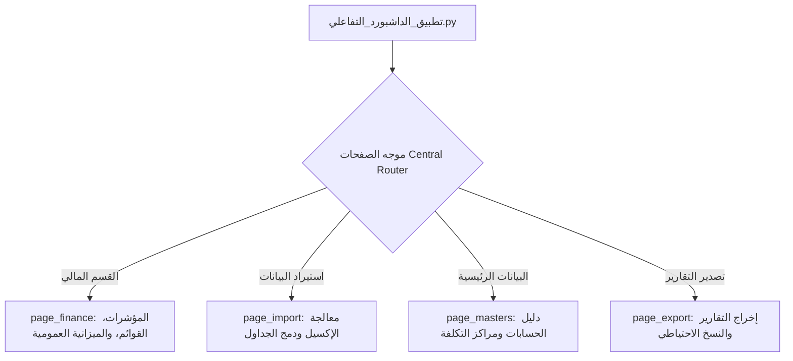

# Project Context
# 🧭 وثيقة السياق الهندسي الموحدة للمشروع (AI Context Blueprint)
> **تنبيه للنموذج المساعد (System Instruction):**
> هذه الوثيقة تمثل المرجع الشامل والنهائي لبنية المشروع وقواعد العمل به. يجب الالتزام الصارم بجميع التوجيهات والخطوط الحمراء الموضحة أدناه عند فحص، تعديل، أو إنشاء أي كود داخل هذا المستودع.

---

## 1. نظرة عامة على المشروع (Project Overview)

- **اسم المشروع:** لوحة تحكم الداشبورد التفاعلي المالي (Interactive Financial Dashboard).
- **البيئة ولغة البرمجة:** Python `3.13.9` (بيئة نظام تشغيل Windows).
- **الترميز القياسي (Encoding):** `UTF-8` إلزامي وشامل لجميع الملفات، المدخلات، المخرجات، والاستعلامات لدعم اللغة العربية دعماً كاملاً ومنع تشوه الحروف (Mojibake).
- **دليل العمل الجذري (Working Directory):** المجلد الحالي `dashboard new` (ويشار إليه برمجياً بالمسار النسبي `.`).
- **طبيعة النظام:** تطبيق تحليلي مالي تفاعلي يعالج القوائم المالية، أرصدة الحسابات (مثل ميزانيات الشركات كـ `شركة_الكوب_الاول_-_Balance_Sheet.xlsx`)، ويقوم بأرشفة دورية للبيانات وربطها بقاعدة بيانات محلية/محدثة.

---

## 2. خريطة الهيكل الشجري للمشروع (Project File Tree)

```text
dashboard new/
│
├── تطبيق_الداشبورد_التفاعلي.py          # [Core] الملف التنفيذي الرئيسي ومحرك الواجهة والموجه
├── تطبيق_الداشبورد_التفاعلي.bat         # [Runner] ملف دفعي لتشغيل التطبيق والبيئة بنقرة واحدة
│
├── fix_all_arabic_aliases.py         # [Utility] سكريبت إصلاح الأسماء المستعارة العربية في استعلامات SQL والجداول
├── fix_sql_arabic.py                 # [Utility] سكريبت متخصص في ضبط محاذاة وترميز نصوص SQL العربية
│
├── قاعدة_البيانات_03/                 # [Data Layer] مستودع ملفات قواعد البيانات (SQLite / Data Stores)
├── أرشيف_شهري_05/                     # [Archive] مجلد حفظ اللقطات التاريخية والتقارير الشهرية المؤرشفة
│
├── شركة_الكوب_الاول_-_Balance_Sheet.xlsx # [Source Data] ملف بيانات مالية تجريبي/فعلي (قائمة المركز المالي)
│
├── output.log                        # [Logs] سجل المخرجات القياسية وعمليات التشغيل
├── err.log                           # [Logs] سجل تتبع الأخطاء والاستثناءات (Runtime Errors)
└── __pycache__/                      # [Cache] ملفات البايثون المترجمة (Bytecode)
```

### أدوار ومسؤوليات الملفات الأساسية:

| الملف / المجلد | الدور الوظيفي وطبيعة العمل |
| :--- | :--- |
| `تطبيق_الداشبورد_التفاعلي.py` | العقل المدبر للتطبيق؛ يحتوي على إعدادات واجهة المستخدم، إدارة الحالة (State Management)، وموجه الصفحات (Page Router). |
| `*.bat` (مثل `تطبيق_الداشبورد_التفاعلي.bat`) | نصوص تشغيل آلية للويندوز لتفعيل البيئة الافتراضية وتشغيل خادم الداشبورد دون الحاجة لفتح الطرفية يدوياً. |
| `fix_all_arabic_aliases.py` & `fix_sql_arabic.py` | أدوات صيانة وترميم لمعالجة مشاكل الـ Aliases واستعلامات SQL التي تحتوي على حقول وأعمدة باللغة العربية. |
| `قاعدة_البيانات_03/` | تخزين جداول العمليات، الحسابات، والبيانات المصنفة المعالجة محلياً. |
| `أرشيف_شهري_05/` | تخزين النسخ الاحتياطية الشهرية وصور التقارير المالية لضمان عدم الكتابة فوق البيانات القديمة. |
| `err.log` & `output.log` | ملفات الرصد والتتبع لتدقيق الأداء والأخطاء أثناء العمليات التفاعلية. |

---

## 3. المعماريّة ومنطق العمل والتوجيه (Architecture & Routing)

يعتمد التطبيق على نمط **تطبيق الصفحة الواحدة (Single Page Application - SPA)** المدعوم بموجه مركزي (Central Page Router) يتحكم في تدفق الشاشات بناءً على حالة الجلسة (`Session State`) أو الاختيار من القائمة الجانبية:



### الدوال الرئيسية للتوجيه (Routing Handlers):
1. **`page_finance()`**:
   - مسؤولة عن عرض لوحات التحكم والتحليلات المالية، قراءة شجرة الحسابات، واحتساب مجاميع قائمة المركز المالي وحسابات الأرباح والخسائر من الملفات المعالجة.
2. **`page_import()`**:
   - مسؤولة عن استيراد ملفات الإكسيل (مثل `شركة_الكوب_الاول_-_Balance_Sheet.xlsx`) والتحقق من سلامة الأعمدة، معالجة ترميز النصوص، وتحويلها إلى جداول مهيكلة داخل `قاعدة_البيانات_03`.
3. **`page_masters()`**:
   - إدارة البيانات الأساسية (Master Data): ربط الفئات المالية، تهيئة شجرة الحسابات، وإدارة قواعد التحويل والتصنيف.
4. **`page_export()`**:
   - تصدير المخرجات النهائية إلى تقارير مهيكلة، إنشاء نسخ في `أرشيف_شهري_05`، وتوليد ملفات تفريغ البيانات.

---

## 4. القواعد الصارمة والخطوط الحمراء للبرمجة (Strict Architectural Constraints)

يجب على أي نموذج ذكاء اصطناعي الالتزام الصارم بالقواعد التالية دون أي استثناء:

### 🔴 القاعدة 1: حظر المسارات المطلقة (Strict Relative Paths)
- **ممنوع تماماً:** كتابة مسارات صلبة ومطلقة مثل `D:\حسابات\...` أو `C:\Users\...`.
- **الإلزام البرمجي:** استخدام مكتبة `pathlib.Path` لحساب مسار الجذر ديناميكياً بناءً على موضع الملف الحالي:
  ```python
  from pathlib import Path
  BASE_DIR = Path(__file__).resolve().parent
  DB_DIR = BASE_DIR / "قاعدة_البيانات_03"
  ARCHIVE_DIR = BASE_DIR / "أرشيف_شهري_05"
  ```

### 🔴 القاعدة 2: فرض الترميز الشامل (Mandatory UTF-8 Encoding)
- نظراً لاحتواء المجلدات، أسماء الملفات، والأعمدة على نصوص عربية صريحة؛ **يجب تحديد `encoding="utf-8"` في كل عمليات فتح الملفات وقراءة البيانات**:
  ```python
  # الصحيح دائماً:
  with open(file_path, "r", encoding="utf-8") as f:
      ...
  df.to_csv(csv_path, encoding="utf-8-sig", index=False)
  ```

### 🔴 القاعدة 3: سياسة الأمان الصفرية للأسرار (Zero-Secrets Policy)
- **ممنوع قطعياً:** كتابة أي مفاتيح API، رموز سرية (Tokens)، أو روابط خدمات داخلية وحساسة (مثل `Paddle`, `CodeCraft`, أو خوادم السحاب) مباشرة داخل الكود المصدري.
- **الإلزام:** قراءة المتغيرات حصراً عبر متغيرات البيئة أو ملفات `.env` غير المتتبعة:
  ```python
  import os
  API_KEY = os.getenv("SERVICE_API_KEY")
  ENDPOINT = os.getenv("SERVICE_ENDPOINT")
  if not API_KEY:
      raise EnvironmentError("Missing required environment variable.")
  ```

### 🔴 القاعدة 4: بروتوكول معالجة السجلات والتتبع (`err.log` و `output.log`)
- يمنع تفريغ (Flush) بيانات حساسة أو أسرار داخل السجلات.
- عند تسجيل الأخطاء في `err.log`، يجب تدوين الختم الزمني ومسار الخطأ الدقيق بصيغة مهيكلة مع الحفاظ على ترميز `utf-8`.
- لا تحذف أو تعيد إنشاء ملفات السجلات أثناء التشغيل الروتيني؛ استخدم أسلوب الإلحاق (`append` mode `a`).

---

## 5. ميثاق تنفيذ المهام للـ AI Agent (Execution Protocol)
1. **التحقق قبل التعديل:** افحص دائماً ما إذا كان هناك دمج لملفات الإصلاح (`fix_*.py`) قبل كتابة استعلامات SQL معقدة باللغة العربية.
2. **سلامة التكامل المالي:** أي تعديل في `page_import` أو `page_finance` يجب ألا يكسر توازن قيود الميزانية أو تصنيف الحسابات الرئيسية.
3. **التشغيل:** يتم الاختبار دوماً بناءً على بيئة المسارات النسبية المتوافقة مع ملف الباتش `تطبيق_الداشبورد_التفاعلي.bat`.
